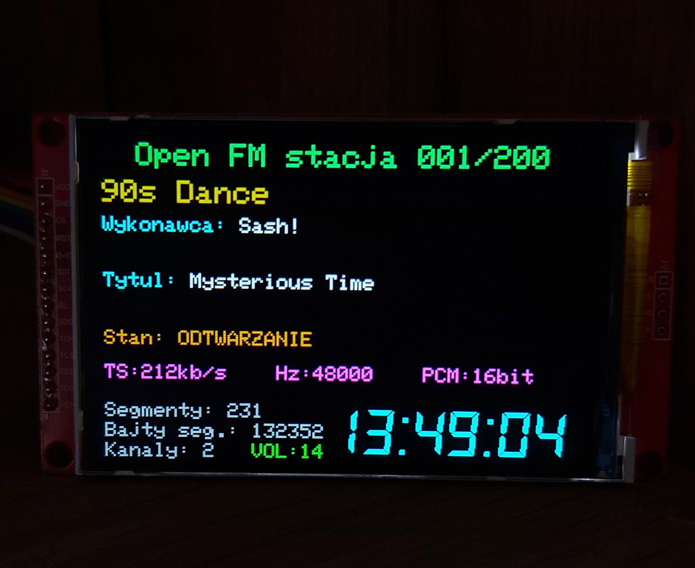

# Internet Radio v4 — OpenFM HLS na ESP32-S3


**Radio internetowe z obsługą kanałów OpenFM**, zbudowane na **ESP32-S3 N16R8** (16 MB Flash, 8 MB PSRAM), z wyświetlaczem **ILI9488 IPS 480 × 320**, przetwornikiem **PCM5102A I2S** i pilotem podczerwieni **NEC**. Radio samodzielnie pobiera aktualny adres HLS z API OpenFM, odtwarza dźwięk AAC, wyświetla nazwę stacji, wykonawcę i tytuł utworu oraz parametry strumienia.

Projekt jest hobbystyczną, **nieoficjalną** implementacją klienta OpenFM — nie jest powiązany organizacyjnie z operatorem usługi.

> **Stan dokumentacji: 12 listopada 2026 r.** Projekt działa na rzeczywistym ESP32-S3, ale nadal jest rozwijany i testowany. Katalog zawiera **200 pozycji**, z czego **189 ma rozpoznany identyfikator `OFMxxx`**, a **11 pozycji pozostaje bez potwierdzonego ID**. Rozpoznanie identyfikatora nie jest równoznaczne z przetestowaniem odtwarzania każdej stacji.

## Radio w praktyce



*Zdjęcie urządzenia z katalogu [`Pictures`](Pictures/20261111_134905.jpg).*

## Spis treści

- [Najważniejsze możliwości](#najważniejsze-możliwości)
- [Aktualny stan funkcji](#aktualny-stan-funkcji)
- [Sprzęt i połączenia](#sprzęt-i-połączenia)
- [Architektura odtwarzania](#architektura-odtwarzania)
- [Katalog 200 stacji](#katalog-200-stacji)
- [Interfejs TFT i polskie znaki](#interfejs-tft-i-polskie-znaki)
- [Sterowanie pilotem NEC](#sterowanie-pilotem-nec)
- [Polecenia monitora Serial](#polecenia-monitora-serial)
- [Próbkowanie 44100 i 48000 Hz](#próbkowanie-44100-i-48000-hz)
- [Metadane ID3v2](#metadane-id3v2)
- [Pliki projektu](#pliki-projektu)
- [Biblioteki i środowisko](#biblioteki-i-środowisko)
- [Instalacja](#instalacja)
- [Diagnostyka i znane ograniczenia](#diagnostyka-i-znane-ograniczenia)
- [Bezpieczeństwo i licencja](#bezpieczeństwo-i-licencja)
- [Podziękowania i źródła](#podziękowania-i-źródła)

## Najważniejsze możliwości

- **Odtwarzanie OpenFM przez HLS** — token dostępu, playlista MASTER, playlista MEDIA i segmenty MPEG-TS są obsługiwane przez własne moduły projektu.
- **Dekodowanie MPEG-TS / AAC** przez `MTSDecoder` i `AACDecoderHelix` z biblioteki Arduino Audio Tools / Helix; dźwięk trafia do przetwornika PCM5102A przez I2S.
- **Automatyczne dopasowanie parametrów I2S** do danych uzyskanych z dekodera AAC, w tym wykrytego próbkowania 44,1 lub 48 kHz.
- **200 nazw stacji w lokalnym katalogu** — bez odpytywania serwisu GETRADIO przez ESP32 przy każdej zmianie kanału.
- **Odczyt metadanych ID3v2** ze strumienia MPEG-TS: wykonawca (`TPE1`) i tytuł (`TIT2`).
- **Polskie litery na ekranie TFT** — własne bitmapy znaków i dekodowanie UTF-8 w `OpenFmPolishText.h`.
- **Przewijana lista ośmiu stacji** z podświetleniem oraz zatwierdzaniem przyciskiem OK.
- **Bezpośredni wybór numeru stacji** z pilota: wpisanie 1–3 cyfr → OK otwiera listę → drugie OK uruchamia wybraną pozycję; między zatwierdzeniami można przewijać listę.
- **Interfejs ILI9488** oparty na `GFXcanvas16`, przesyłaniu RGB666 przez SPI **40 MHz** i częściowym odświeżaniu zmienionych obszarów.
- **Konfigurowalna paleta nazwanych kolorów RGB565** w przestrzeni nazw `Kolory` (49 kolorów).
- **Zegar NTP** z dużą czcionką `DS_DIGII35pt7b` i automatyczną zmianą czasu CET/CEST.
- **WiFiManager**, monitor Serial 115200 oraz osobne zadania FreeRTOS dla pobierania HLS i dekodowania audio.

## Aktualny stan funkcji

| Funkcja | Stan | Informacja |
|---|---|---|
| Token OpenFM, MASTER/MEDIA i odtwarzanie MPEG-TS/AAC | ✅ Działa | Potwierdzone testami na ESP32-S3 |
| Odczyt wykonawcy i tytułu z ID3v2 | ✅ Działa | Sprawdzone na strumieniach nadających właściwe tagi |
| Katalog lokalny | ✅ 200 pozycji | 189 ID rozpoznanych, 11 niepotwierdzonych |
| Przewijana lista i wybór numeru | ✅ Zaimplementowane | Akceptacja przez OK, bez zatrzymywania bieżącej stacji podczas przeglądania |
| Polskie znaki UTF-8 | ✅ Zaimplementowane | Własne glify dla polskich liter; inne znaki Unicode mogą być ograniczone |
| Próbkowanie I2S | ✅ Zaimplementowane | Przełączenie z 44,1 na 48 kHz potwierdzone w logach; warto dalej testować różne stacje |
| Wyświetlanie parametrów TS, Hz, PCM, kanałów i głośności | ✅ Zaimplementowane | Wartości dostępne z dekodera i liczników strumienia |
| Częściowe odświeżanie listy TFT | 🧪 W testach | Ogranicza liczbę przesyłanych pikseli; responsywność jest nadal obserwowana |
| Obsługa każdego wpisu w katalogu i każdego wariantu HLS | ❌ Niepotwierdzona | Niektóre pozycje mogą prowadzić do zewnętrznych strumieni |
| Produkcyjna weryfikacja certyfikatów TLS | ⏳ Do wykonania | W module sieciowym nadal użyto `setInsecure()` |

## Sprzęt i połączenia

### Moduły

- **ESP32-S3 N16R8** — 16 MB Flash, 8 MB PSRAM.
- **ILI9488 IPS 480 × 320** — ekran TFT z magistralą SPI.
- **PCM5102A** — przetwornik DAC z wejściem I2S.
- **Odbiornik podczerwieni** i pilot zgodny z protokołem NEC.
- Zasilanie modułów, wspólna masa, wyjście analogowe do wzmacniacza/głośników oraz Wi-Fi.

### GPIO

| Funkcja | ESP32-S3 | Podłączenie |
|---|---:|---|
| TFT CS | GPIO 5 | ILI9488 CS |
| TFT DC | GPIO 4 | ILI9488 DC / RS |
| TFT SCK | GPIO 11 | ILI9488 SCK |
| TFT MOSI | GPIO 12 | ILI9488 MOSI / SDI |
| TFT MISO | GPIO 13 | ILI9488 MISO / SDO, jeśli używany |
| Odbiornik IR | GPIO 15 | OUT odbiornika NEC |
| I2S BCLK | GPIO 16 | PCM5102A BCK |
| I2S DATA | GPIO 17 | PCM5102A DIN |
| I2S LRCK / WS | GPIO 18 | PCM5102A LCK / LRCK |

**Uwaga:** podłączenia dotyczą konkretnej konfiguracji projektu. Sprawdź zasilanie, napięcia sygnałów i wymagania własnego modułu TFT. Obsługa sprzętowego RESET i podświetlenia zależy od wersji płytki wyświetlacza.

## Architektura odtwarzania

```text
  Pilot NEC / Serial
         |
  ESP32S3_OpenFM.ino  ───────────> GFXcanvas16 / ILI9488
         |                              ^
         v                              |
  OpenFmCatalog.cpp             OpenFmPolishText.h
  nazwa / slug / OFM ID                |
         |                              |
         v                              |
  OpenFmResolver.cpp                    |
  API tokenu OpenFM                     |
         |                              |
         v                              |
  HLS MASTER -> MEDIA -> segmenty MPEG-TS
                         |
                 +-------+-------+
                 |               |
                 v               v
         OpenFmPlayer.cpp   OpenFmMetadata.cpp
         MTSDecoder         PAT / PMT / PES
         AACDecoderHelix    ID3v2: TIT2 / TPE1
         VolumeStream              |
         I2SStream                 +----> wykonawca / tytuł na TFT
                 |
                 v
              PCM5102A
                 |
                 v
           WYJŚCIE AUDIO
```

### Pobieranie playlist i segmentów

1. `OpenFmCatalog` przekazuje identyfikator stacji (np. `OFM149`).
2. `OpenFmResolver` buduje bazowy adres playlisty i odpytuje `https://open.fm/api/user/token?fp=...`.
3. Z odpowiedzi JSON pobierane jest pole `url` zawierające **czasowy adres** strumienia.
4. `OpenFmPlayer` pobiera playlistę MASTER, następnie playlistę MEDIA i kolejne segmenty `.ts`.
5. Segmenty są kierowane do kolejki dekodera oraz niezależnie do parsera ID3.
6. Dane AAC po dekodowaniu trafiają na I2S i do PCM5102A.

Projekt korzysta z własnej obsługi HLS, zamiast polegać na gotowym `HLSStream.h`. Nie przechowuje wygasających tokenów w statycznym katalogu.

## Katalog 200 stacji

Katalog `OpenFmCatalog.cpp` zawiera dla każdej pozycji:

```cpp
{"Trap PL", "trap-pl", 149},
{"Impreza PL", "impreza-pl", 154},
```

Kolejne pola to **nazwa na ekranie**, **slug katalogowy** i **liczbowy identyfikator OFM**. Numer pozycji na ekranie (`001–200`) nie jest numerem `OFMxxx`.

### Skąd pochodzą identyfikatory?

Nazwy i slugi zebrano z katalogu [GETRADIO — OpenFM](https://getradio.reconv.pl/openfm). Pierwotnie ESP32 miało odczytywać identyfikatory z przekierowań, jednak serwis odpowiadał urządzeniu błędem **HTTP 403** związanym z ochroną Cloudflare.

Dlatego przygotowano skrypt **PowerShell dla Windows**, który wykorzystywał przeglądarkę Chrome lub Edge do otwierania adresów z odpowiednimi slugami, np.:

```text
https://getradio.reconv.pl/openfm?s=trap-pl
```

Z przekierowania do adresu zawierającego `/OFM149/` pobierany był wyłącznie identyfikator — **bez zapisywania czasowego tokenu**. Wyniki trafiały do `openfm_stations.csv`, a następnie do statycznej tablicy C++.

**Stan na 12 listopada 2026 r.:** 200 pozycji katalogowych, **189 rozpoznanych identyfikatorów** i **11 pozycji z `fixedId = 0`**. Najnowszym potwierdzonym wpisem jest `Impreza PL -> OFM154`. Niektóre stacje z katalogu są radiami zewnętrznymi (np. mogą przekierowywać do MP3), a nie kanałami `OFMxxx` obsługiwanymi przez ten odtwarzacz. Wpis `fixedId = 0` nie oznacza automatycznie, że dana stacja przestała nadawać.

W aktualnym odtwarzaczu **ESP32 nie wysyła zapytań do GETRADIO przy zmianie stacji**. Funkcja `resolveId()` odczytuje przypisanie z lokalnej tablicy.

## Interfejs TFT i polskie znaki

Wyświetlacz **ILI9488 480 × 320** działa z buforem `GFXcanvas16` (RGB565). Program przelicza piksele na RGB666 i przesyła je przez SPI ustawione na **40 MHz**:

```cpp
spi.beginTransaction(SPISettings(40000000, MSBFIRST, SPI_MODE0));
```

### Ekran główny

- Nagłówek **„Open FM stacja 001/200”**.
- Nazwa stacji dużą czcionką, o skali odpowiadającej nagłówkowi.
- **Wykonawca** i **Tytuł**: etykieta w wyróżnionym kolorze, tekst od razu po dwukropku i spacji; w razie potrzeby zawijany do drugiej linii.
- Stan odtwarzania.
- `TS`, `Hz` i `PCM` w jednym wierszu.
- Liczba segmentów, bajty ostatniego kompletnego segmentu, liczba kanałów i głośność w dolnym lewym obszarze.
- Zegar **HH:MM:SS** w prawym dolnym obszarze, z zachowaną czcionką `DS_DIGII35pt7b`.

**Znaczenie wartości:** `TS` to oszacowana przepływność *kontenera MPEG-TS*, nie gwarantowany bitrate samego AAC. `PCM 16 bit` oznacza format sygnału **po dekodowaniu**, a nie rozdzielczość źródłowego skompresowanego pliku.

### Polska czcionka UTF-8

Własny moduł `OpenFmPolishText.h` obsługuje:

```text
Ą Ć Ę Ł Ń Ó Ś Ź Ż
ą ć ę ł ń ó ś ź ż
```

Zwykłe litery pozostają rysowane przez Adafruit GFX. Dodatkowe bitmapy i dekoder UTF-8 pozwalają wyświetlać polskie litery w nazwie stacji, wykonawcy i tytule. Ograniczanie długości napisów uwzględnia szerokość w pikselach; obsługa całego Unicode nie jest celem tego modułu. Czcionka zegara jest niezależna.

### Menu i odświeżanie

- Lista pokazuje **8 stacji** na ekranie.
- Zaznaczenie ma własne tło i kolor tekstu; numer oraz nazwa są rysowane w spójnych barwach, również przy polskich literach.
- Przy typowym przesunięciu zaznaczenia aktualizowane są tylko zmienione wiersze i mały fragment nagłówka.
- Gdy zmienia się zakres ośmiu widocznych pozycji, odświeżany jest odpowiedni obszar listy, bez niepotrzebnego rysowania całego ekranu w każdym kroku.
- Bieżące odtwarzanie **nie jest przerywane podczas samego przeglądania**; strumień zmienia się dopiero po zatwierdzeniu.

Prace nad responsywnością menu nadal są testowane. W szczególności opóźnienie aktualizacji głośności na TFT może różnić się od chwili faktycznej zmiany poziomu audio.

### Nazwane kolory RGB565

Kolory są zebrane na początku głównego szkicu w przestrzeni nazw `Kolory`. Przykład:

```cpp
canvas.setTextColor(Kolory::CYJAN);
canvas.setTextColor(Kolory::ZLOTY);
canvas.fillRect(0, 0, WIDTH, HEIGHT, Kolory::CZARNY);
```

W palecie znajduje się **49 nazwanych kolorów**. Zmiana wartości przypisanej nazwie modyfikuje wszystkie miejsca używające danego koloru. Nie należy mylić stałych RGB565 z szesnastkowymi kodami rozkazów wyświetlacza lub pilota.

## Sterowanie pilotem NEC

Pilot jest dekodowany bezpośrednio z przerwań GPIO 15, bez obowiązkowej zewnętrznej biblioteki IR.

| Przycisk / kod NEC | Działanie |
|---|---|
| Prawo `0x26` | Natychmiast następna stacja |
| Lewo `0x27` | Natychmiast poprzednia stacja |
| Dół `0x22` | Otwórz listę / przesuwaj zaznaczenie w dół |
| Góra `0x30` | Otwórz listę / przesuwaj zaznaczenie w górę |
| OK `0x25` | Wpisany numer → lista; lista → odtwarzanie; poza nimi ponowny start |
| STOP `0x33` | Anuluj wpisywanie / zamknij listę; poza nimi zatrzymaj audio |
| VOL+ `0x28` | Zwiększ głośność |
| VOL− `0x24` | Zmniejsz głośność |
| MUTE `0x29` | Włącz / wyłącz wyciszenie |
| FF+ `0x18`, FF− `0x19` | Następna / poprzednia stacja |

### Wybór numeryczny — dwa zatwierdzenia OK

1. Na pilocie wpisz numer pozycji, np. **125** — maksymalnie trzy cyfry.
2. **Pierwsze OK** otwiera przewijaną listę z podświetloną pozycją 125, nie przerywając aktualnej muzyki.
3. Opcjonalnie użyj **góra/dół**, aby skorygować wybór.
4. **Drugie OK** przełącza radio na zaznaczoną stację.

Aktualnie używane kody NEC cyfr w szkicu:

| Cyfra | Kod | Cyfra | Kod |
|---:|---|---:|---|
| 0 | `0x12` | 5 | `0x10` |
| 1 | `0x15` | 6 | `0x09` |
| 2 | `0x14` | 7 | `0x07` |
| 3 | `0x08` | 8 | `0x06` |
| 4 | `0x11` | 9 | `0x05` |

Kody dotyczą konkretnego pilota. Przy innym nadajniku trzeba zaktualizować mapowanie w `handleRemote()`.

## Polecenia monitora Serial

Prędkość: **115200 baud**.

| Polecenie | Znaczenie |
|---|---|
| `g 1` … `g 200` | Wybór pozycji katalogu |
| `1` … `9` | Szybki wybór pierwszych dziewięciu pozycji |
| `n` / `p` | Następna / poprzednia stacja |
| `o OFM10` | Uruchomienie kanału po bezpośrednim identyfikatorze OFM |
| `s` | STOP |
| `r` | Uruchom ponownie |
| `+` / `-` | Głośniej / ciszej (`0..21`) |
| `m` | Statystyki i diagnostyka |
| `meta Artysta\|Tytuł` | Ręczny test metadanych na ekranie (bez pobierania ich z OpenFM) |
| `h` | Pomoc |

## Próbkowanie 44100 i 48000 Hz

Pierwotnie wyjście I2S startowało z ustawieniem **44 100 Hz**, podczas gdy badany strumień AAC korzystał z **48 000 Hz**. Powodowało to zbyt wolną muzykę i obniżenie wysokości dźwięku.

Obecny moduł `OpenFmPlayer.cpp`:

1. inicjalizuje I2S z formatem startowym;
2. odczytuje aktualne `AudioInfo` z dekodera `AACDecoderHelix`;
3. sprawdza częstotliwość, liczbę kanałów i rozdzielczość PCM;
4. przy wykryciu zmiany przekazuje nowe ustawienia do `VolumeStream` / `I2SStream`;
5. rejestruje zmianę w logu, np.:

```text
[AAC] / [Helix] sample_rate: 48000 / channels: 2
[I2S] Automatyczna zmiana formatu: 44100 -> 48000 Hz, 2 kan., 16 bit
```

Działa również mechanizm propagacji informacji o formacie z dekodera (`decoded.addNotifyAudioChange(volumeOutput)`). **Przejście do 48 kHz zostało potwierdzone na rzeczywistym urządzeniu**. Dalsze testy różnych stacji, w tym powrotu do 44,1 kHz, nadal są wskazane.

## Metadane ID3v2

`OpenFmMetadata.cpp` analizuje niezależnie od audio pakiety **MPEG-TS** o długości 188 bajtów:

1. odnajduje tablicę **PAT**;
2. ustala PID tablicy **PMT**;
3. wyszukuje strumień metadanych o `stream_type = 0x15`;
4. składa dane **PES**;
5. odnajduje sygnaturę **ID3**;
6. odczytuje ramki `TPE1` (wykonawca) oraz `TIT2` (tytuł).

Parser obsługuje występujące w ID3 kodowania tekstu, w tym ISO-8859-1, UTF-8 i UTF-16. Informacje są bezpiecznie przekazywane do głównej pętli wyświetlacza.

Przykładowe logi z testów:

```text
[ID3] PAT: PMT PID=0xFFF
[ID3] PMT: metadata PID=0x102 (stream_type=0x15)
[ID3] Sygnatura ID3 wykryta (nr=1)
[ID3] Nowe metadane: wykonawca=twocolors | tytul=Mad World
[ID3] TS=3530 PMT=0xFFF PID=0x102 pakiety_meta=1 PES=1 PES_bad=0 bajty_PES=83 ID3_headers=1 tagi=1
```

> PID `0x102` jest przykładem z konkretnego strumienia, nie stałą dla wszystkich kanałów. Komunikat dekodera `Packet ignored for PID 0x102` może być normalny: dekoder dźwięku pomija pakiety metadanych, które osobno obsługuje `OpenFmMetadata`.

Nazwy stacji **nie są pobierane z ID3**. Pochodzą z lokalnego katalogu. To, że nie odczytujemy nazwy stacji z tagów ID3, nie dowodzi, że serwis nie udostępnia jej inną drogą.

## Pliki projektu

```text
ESP32S3_OpenFM/
├── ESP32S3_OpenFM.ino       # Program główny, TFT, pilot, menu, Wi-Fi, NTP
├── OpenFmCatalog.h
├── OpenFmCatalog.cpp       # Statyczna tablica 200 pozycji i identyfikatorów
├── OpenFmResolver.h
├── OpenFmResolver.cpp      # Token OpenFM i aktualny adres HLS
├── OpenFmPlayer.h
├── OpenFmPlayer.cpp        # Pobieranie HLS, dekodowanie AAC, I2S, FreeRTOS
├── OpenFmMetadata.h
├── OpenFmMetadata.cpp      # PAT, PMT, PES, ID3v2
├── OpenFmPolishText.h     # Polskie glify i obsługa UTF-8
├── DS_DIGII35pt7b.h       # Czcionka zegara
├── Pictures/
│   └── 20261111_134905.jpg
├── README.md
└── LICENSE                 # Jeśli dołączony w repozytorium
```

Nazwa głównego pliku `.ino` **musi odpowiadać nazwie folderu szkicu**. Pracuj na spójnym komplecie `.ino`, `.cpp`, `.h` i nie łącz przypadkowo plików z różnych etapów rozwoju radia.

## Biblioteki i środowisko

Do testów używano **Arduino IDE** i pakietu **Espressif Arduino-ESP32 Core 3.3.12**.

| Biblioteka / komponent | Rola | Źródło |
|---|---|---|
| Arduino-ESP32 Core **3.3.12** | ESP32-S3, Wi-Fi, SPI, I2S, HTTPS, FreeRTOS | [Espressif](https://github.com/espressif/arduino-esp32) |
| Arduino Audio Tools / używany wariant DevLab | Strumienie, I2S, `MTSDecoder`, `VolumeStream`, bufor RTOS | [Arduino Audio Tools](https://github.com/pschatzmann/arduino-audio-tools), [DevLab fork](https://github.com/UNIT-Electronics-MX/unit_devlab_fork_arduino_audio_tools) |
| arduino-libhelix | Dekodowanie AAC | [Helix](https://github.com/pschatzmann/arduino-libhelix) |
| ArduinoJson | Odpowiedź JSON API tokenu | [ArduinoJson](https://github.com/bblanchon/ArduinoJson) |
| WiFiManager | Portal konfiguracji Wi-Fi | [WiFiManager](https://github.com/tzapu/WiFiManager) |
| Adafruit GFX | `GFXcanvas16`, rysowanie tekstu | [Adafruit GFX](https://github.com/adafruit/Adafruit-GFX-Library) |
| `OpenFmPolishText.h`, `DS_DIGII35pt7b.h` | Lokalna obsługa czcionek | Pliki dołączone do projektu |

**Wersje pozostałych bibliotek** należy sprawdzić w instalacji, na której wykonano udaną kompilację. Nie podano tu niezweryfikowanych numerów wersji. W szczególności biblioteki Audio Tools i Helix powinny odpowiadać kompatybilnemu zestawowi użytemu w działającym firmware.

## Instalacja

1. Zainstaluj Arduino IDE oraz pakiet płytek ESP32, korzystając z konfiguracji zgodnej z ESP32-S3 N16R8.
2. Włącz PSRAM zgodnie z modułem i ustawieniami płyty.
3. Zainstaluj odpowiednie biblioteki z tabeli powyżej.
4. Umieść **wszystkie pliki źródłowe** w jednym folderze `ESP32S3_OpenFM`, włącznie z `OpenFmPolishText.h` i `DS_DIGII35pt7b.h`.
5. Otwórz **`ESP32S3_OpenFM.ino`**, skompiluj i wgraj program.
6. Otwórz monitor Serial z prędkością **115200**.
7. Przy pierwszym uruchomieniu skonfiguruj Wi-Fi w portalu WiFiManager (`ESP32S3-OpenFM-TEST`, jeśli nazwa nie została zmieniona w szkicu).
8. Po połączeniu radio rozpoczyna odtwarzanie pierwszej pozycji katalogu. Stacje wybieraj pilotem lub poleceniami Serial.

Nie kopiuj zawartości nowego `.ino` na koniec poprzedniego: zastąp **cały plik**. Dwie definicje `setup()` / `loop()` lub dołączenie nagłówka w środku funkcji prowadzą do błędów kompilacji.

## Diagnostyka i znane ograniczenia

| Objaw / komunikat | Co sprawdzić |
|---|---|
| `Packet ignored for PID 0x102` | Może dotyczyć PID metadanych, które dekoder audio celowo pomija. Sprawdź, czy ID3 i audio działają. |
| `Sync byte not found` | Ostrzeżenie dekodera MPEG-TS; pojedynczy wpis nie musi oznaczać problemu. Przy częstych zakłóceniach sprawdź spójność segmentów. |
| Muzyka za wolna / za niska | Porównaj częstotliwość AAC z I2S; szukaj komunikatu automatycznej zmiany formatu. |
| Pauza w dźwięku podczas przewijania | Sprawdź, czy aktywna jest zoptymalizowana wersja częściowego odświeżania listy TFT. |
| Zmiana głośności pojawia się później na TFT | Dźwięk może reagować szybciej niż okresowe odświeżanie panelu parametrów. |
| Brak wykonawcy/tytułu | Nie każdy kanał nadaje tagi ID3; po starcie pierwsza aktualizacja może pojawić się z opóźnieniem. |
| `fixedId=0` | Dla tej pozycji brak potwierdzonego identyfikatora OFM. Nie przypisuj przypadkowego numeru. |
| `HTTP 403` z GETRADIO | Lokalny katalog nie wymaga GETRADIO przy odtwarzaniu; identyfikatory zbierano wcześniej skryptem komputerowym. |
| `undefined reference to setup()` / `loop()` | Sprawdź nazwę katalogu `.ino`, obecność kompletnego szkicu i brak jego przypadkowego sklejenia. |
| Brak polskich znaków | Sprawdź obecność `OpenFmPolishText.h` i czy napisy trafiają do funkcji obsługującej UTF-8. |
| Zegar nie aktualizuje się | Sprawdź Wi-Fi, NTP i strefę czasu Polski. |

### Ograniczenia implementacji HLS

- Odtwarzacz jest przeznaczony przede wszystkim dla **nieszyfrowanych segmentów MPEG-TS z AAC**.
- Aktualna ścieżka pobierania segmentów wymaga znanego `Content-Length` i nie obsługuje wprost wszystkich transferów `chunked`.
- HLS z `EXT-X-KEY`, fMP4 (`EXT-X-MAP`), DRM lub innymi kodekami wymaga odrębnej implementacji.
- Bufor odtwarzania wynosi około **96 KiB**; połączenia HTTPS i odświeżanie ekranu mogą wpływać na płynność w trudnych warunkach sieciowych.
- Nie wszystkie z 200 pozycji są źródłami OpenFM HLS; istnieją wpisy kierujące do niezależnych rozgłośni.

## Bezpieczeństwo i licencja

- **TLS:** obecny kod używa w wybranych miejscach `WiFiClientSecure::setInsecure()`, co wyłącza weryfikację certyfikatu serwera. Przed zastosowaniem produkcyjnym należy wdrożyć poprawną weryfikację TLS.
- **Tokeny:** nigdy nie publikuj aktywnych adresów HLS z tokenami, danych Wi-Fi ani innych sekretów w repozytorium i logach.
- **Nieoficjalne API:** mechanizm pobierania tokenów, działanie CDN i katalog stacji mogą ulec zmianie bez zapowiedzi.
- **Prawa do zasobów:** przed publikacją sprawdź warunki korzystania z OpenFM oraz pochodzenie i licencje dołączonych czcionek i zależności.
- **GPL-3.0-only:** kod własny repozytorium jest publikowany na zasadach tej licencji, o ile autor posiada do niego odpowiednie prawa. Pełną treść należy udostępnić w pliku [`LICENSE`](LICENSE). Biblioteki zewnętrzne zachowują własne licencje.
- Projekt udostępniany jest **bez gwarancji**, w zakresie dozwolonym przez obowiązujące prawo.

## Dalszy rozwój

- [x] Odtwarzanie OpenFM HLS i dekodowanie AAC na ESP32-S3.
- [x] Metadane wykonawcy i tytułu z ID3v2.
- [x] Lokalny katalog 200 pozycji z identyfikatorami OFM.
- [x] Lista z podświetleniem, wybór numeryczny i dwustopniowe OK.
- [x] Polskie litery w nazwach stacji i metadanych.
- [x] Nazwana paleta kolorów RGB565.
- [x] Automatyczne dostosowanie formatu I2S na podstawie AAC.
- [x] Częściowe odświeżanie przewijanej listy TFT.
- [ ] Dokończenie weryfikacji brakujących identyfikatorów i testów wszystkich pozycji.
- [ ] Dłuższe testy stabilności i responsywności ekranu.
- [ ] Pełna weryfikacja TLS oraz odporności na zmiany API.
- [ ] Opcjonalne zapisywanie ulubionych / ostatnio słuchanej stacji.
- [ ] Opcjonalne dodatkowe informacje z ID3, jeśli nadawcy je transmitują.

## Podziękowania i źródła

Projekt powstał w oparciu o dokumentację otwartych bibliotek, wskazówki społeczności i wielokrotne testy na fizycznym urządzeniu.

| Projekt / autor | Wkład |
|---|---|
| [Phil Schatzmann — Arduino Audio Tools](https://github.com/pschatzmann/arduino-audio-tools) | Strumienie audio, I2S, bufory, dekodery |
| [Phil Schatzmann — arduino-libhelix](https://github.com/pschatzmann/arduino-libhelix) | Dekoder AAC Helix |
| [UNIT Electronics / DevLab](https://github.com/UNIT-Electronics-MX/unit_devlab_fork_arduino_audio_tools) | Używany wariant biblioteki Audio Tools |
| [Benoît Blanchon — ArduinoJson](https://github.com/bblanchon/ArduinoJson) | Parsowanie JSON |
| [tzapu — WiFiManager](https://github.com/tzapu/WiFiManager) | Konfiguracja Wi-Fi |
| [Adafruit — GFX](https://github.com/adafruit/Adafruit-GFX-Library) | Canvas i grafika na TFT |
| [Espressif — Arduino-ESP32](https://github.com/espressif/arduino-esp32) | Platforma ESP32-S3 i peryferia |
| [GETRADIO](https://getradio.reconv.pl/openfm) | Publiczny katalog nazw i slugów stacji |
| [GorlikItsMe — opis API tokenu](https://gist.github.com/GorlikItsMe/4c90cba803c3ec097dbcb5ce44e65bef) | Publiczny przykład uzyskania czasowego URL OpenFM |
| [Społeczność Elektroda — HLS/ID3v2](https://www.elektroda.pl/rtvforum/viewtopic.php?p=22000329#22000329) | Wskazówki dotyczące odczytu ID3 z PID MPEG-TS |

Dodatkowe materiały: [artykuł o HLS w Arduino Audio Tools](https://www.pschatzmann.ch/home/2025/04/09/http-live-streaming-hls-with-the-arduino-audio-tools/).

Opracowanie i rozwój kodu odbywały się iteracyjnie, z pomocą **ChatGPT** oraz weryfikacją działania na prawdziwym ESP32-S3.

### Znaki towarowe

**OpenFM** i nazwy poszczególnych stacji należą do ich prawnych właścicieli. Repozytorium **nie jest oficjalnym projektem OpenFM**, nie jest przez operatora sponsorowane ani zatwierdzone.

---

Jeżeli projekt okazał się pomocny, możesz oznaczyć repozytorium ⭐, zgłosić problem w **Issues** lub zaproponować poprawkę przez **Pull Request**. Szczególnie przydatne są wyniki testów stacji, błędy dekodowania ID3 i pomiary płynności działania TFT.
